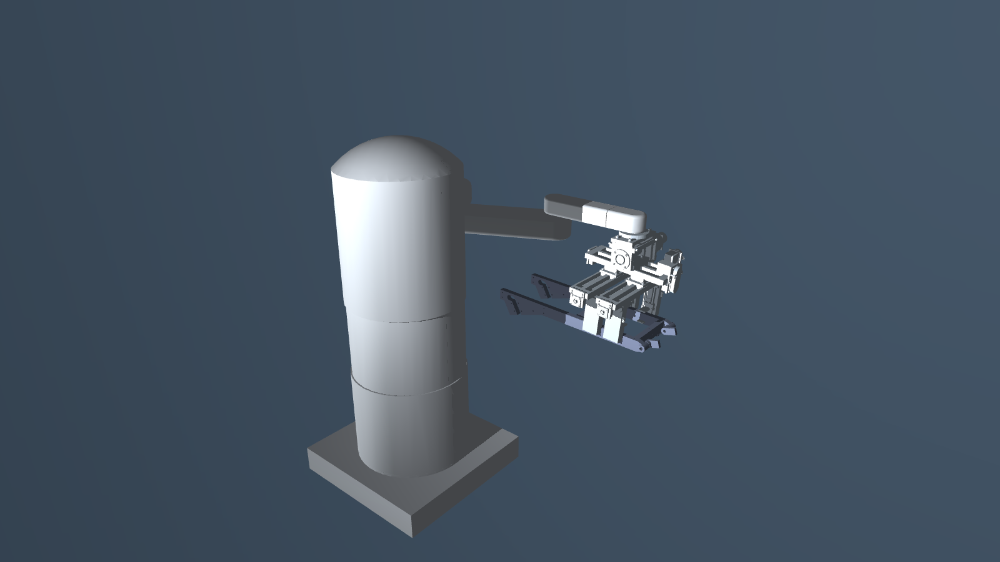

# ROBOT SCARA R1

[](https://github.com/chanhuynguyen-ai/ROBOT-SCARA-R1/actions/workflows/validation.yml)

Mô phỏng robot **SCARA R1** tích hợp đầu kẹp **GF01 R02** để gắp, vận chuyển và đưa **G23** vào cụm bánh xe trong MuJoCo.

**Baseline:** P7 · **Tham chiếu:** V13 · **Quỹ đạo:** 2.622 frame / 13 pha · **Phạm vi:** nghiên cứu động học và hình học.



*Hình từ scene MuJoCo P7, chỉ hiển thị R1, GF01 và G23 để quan sát cơ cấu.*

## Thành phần

| Thành phần | Vai trò |
|---|---|
| SCARA R1 | Cánh tay 4 khớp J1–J3–J2–J4 |
| GF01 R02 | Cơ cấu pitch và bốn cụm kẹp C gắn vào robot |
| G23 | Chi tiết gắp xe được nâng và đưa vào vị trí lắp |
| G08 / G56 | Bánh sau, trục tham chiếu và bánh trước trong cell |
| P7 | Nhánh CAD hai rãnh R13, kế thừa quỹ đạo P6 FIX1 |

## Cấu trúc project

```text
ROBOT-SCARA-R1/
├── simulation/p7/       # mã mô phỏng, CAD G23, quỹ đạo và kiểm tra hình học
├── reference/v13/       # controller, scene R1–GF01 và mesh nguồn được chốt SHA-256
├── scripts/             # điểm vào dùng đường dẫn tương đối của repository
├── reports/             # kết quả kiểm chứng baseline
├── docs/                # kiến trúc, lịch sử và nguồn gốc dữ liệu
└── .github/workflows/    # kiểm tra tự động trên Windows và Linux
```

## Trạng thái kỹ thuật

- Đủ **107 mesh** của scene nền; kiểm tra SHA-256 cho tài nguyên và dữ liệu tham chiếu.
- Đã phát lại **2.622 frame** bằng MuJoCo, giữ datum đặt cuối và quan hệ lắp GF01–R1.
- P7 tăng khoảng hở danh nghĩa trong phép kiểm tiết diện 2D từ **0,794 mm** lên **2,972 mm**, qua **8.732 mẫu**.
- Mô phỏng sử dụng `mj_forward`. Lực kẹp, lực tiếp xúc và va chạm 3D liên tục chưa được kiểm định trong baseline này.

## Tài liệu project

[Kiến trúc](docs/ARCHITECTURE.md) · [Kiểm chứng](docs/VALIDATION.md) · [Lịch sử](docs/HISTORY.md) · [Nguồn dữ liệu](docs/PROVENANCE.md)
