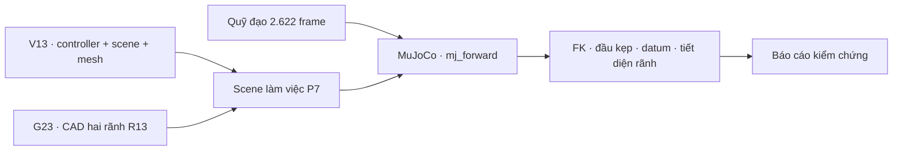

# Kiến trúc R1 / GF01 / G23

Project chia dữ liệu nguồn, nhánh P7 và kết quả sinh ra thành các lớp riêng. Một bản scene làm việc được tạo từ tham chiếu V13; nguồn tham chiếu không bị sửa trong quá trình kiểm tra hoặc phát lại.

## Nhánh P7

`simulation/p7/tools` chứa bộ dựng scene, viewer và công cụ CAD. `assets` giữ STEP, STL, đường tâm rãnh và tiết diện đối chiếu. `config` lưu hệ tọa độ và các nguồn đã chốt mã băm. `outputs` là dữ liệu baseline được theo dõi phiên bản, gồm quỹ đạo và kết quả hình học gốc; đây không phải thư mục kết quả của các lần chạy mới.

Mã nguồn P7 giữ thuật toán hình học và chuyển động từ bản ngày 29/10/2026. Các thay đổi cho repository giới hạn ở đường dẫn tham chiếu và bộ xác minh snapshot đã tinh gọn.

## Tham chiếu V13

`reference/v13/controller` giữ controller, core, hiệu chuẩn và quỹ đạo V13. `scene` giữ XML tích hợp R1–GF01 và 107 STL được XML tham chiếu. `trajectories/v10.csv` cung cấp mốc truy vết từ V10. ZIP V5.1.3 trong controller là đầu vào tham chiếu được hiệu chuẩn chốt SHA-256.

Đây là snapshot runtime đã tuyển chọn từ gói V13, có manifest mới cho bố trí repository. Các file nguồn được giữ lại vẫn khớp mã băm ban đầu; snapshot này không tự nhận là toàn bộ gói phân phối V13 nguyên trạng.

## Dữ liệu sinh ra

Điểm vào trong `scripts` xác định nguồn theo vị trí repository, không phụ thuộc Downloads hoặc tên tài khoản Windows. Scene làm việc và báo cáo của các lần kiểm tra mới đi vào `artifacts/`; thư mục này không nằm trong lịch sử Git.

## Hệ tọa độ và phạm vi

- Các tọa độ scene dùng mét; CAD STEP và phép kiểm tiết diện dùng milimét theo cấu hình đối chiếu.
- Trục đứng của scene tham chiếu là Y.
- Datum G23 cuối giữ tại `(-0.30285, -0.24368, 0)` m.
- Trạng thái G23 và đóng mở kẹp được điều khiển theo quỹ đạo. Các nhãn trạng thái không thay thế xác minh lực giữ hoặc tiếp xúc vật lý.
