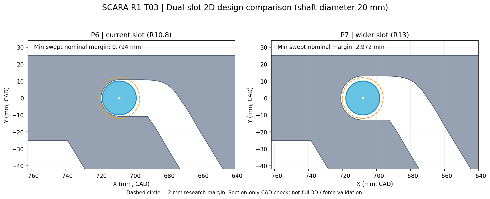

# Kiểm chứng baseline

Bản bố trí repository được kiểm tra lại ngày **19/11/2026**. Kết quả máy đọc nằm trong [reports/baseline.json](../reports/baseline.json).

| Lớp kiểm tra | Kết quả cục bộ |
|---|---|
| Manifest P7 | PASS — 19 file |
| Manifest V13 runtime | PASS — 115 file và các ghim nguồn nguyên bản |
| Phụ thuộc scene | Đủ 107/107 mesh |
| Hồi quy hình học và dữ liệu | PASS — 5 kiểm tra |
| Native MuJoCo | PASS_KINEMATIC_REPLAY_ONLY — 2.622 frame |
| Giữ quan hệ bốn điểm đầu kẹp và datum cuối | Qua các gate động học của baseline |
| Quét tiết diện hai rãnh | 8.732 mẫu, biên hở danh nghĩa nhỏ nhất khoảng 2,972 mm |

## Kiểm tra tự động

Workflow Validation kiểm manifest, các hồi quy hình học và native replay trên **Windows / Linux, Python 3.12**. CI không mở cửa sổ đồ họa và không tạo gói phân phối.

## Ý nghĩa kết quả

Các kết quả hiện tại chứng minh tính toàn vẹn nguồn, phát lại động học và những phép kiểm hình học được ghi cụ thể. MuJoCo sử dụng `mj_forward`; contact geom của G23 bị vô hiệu trong baseline.

Chưa có kiểm định lực kẹp, giữ tải, phản lực lắp, độ bền cơ khí hoặc va chạm lưới 3D liên tục cho toàn bộ cell. Baseline chưa đủ điều kiện làm teacher thành công cho huấn luyện điều khiển hoặc triển khai robot vật lý.
